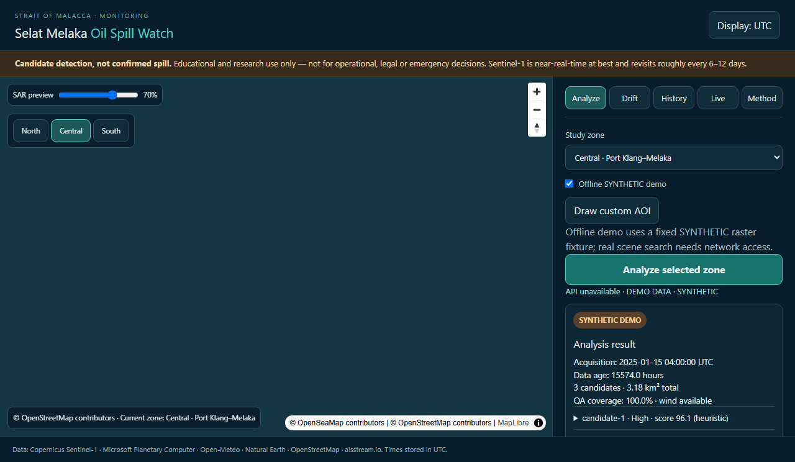
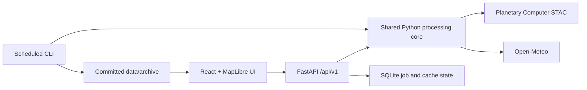

# Selat Melaka Oil Spill Watch

An open-source GIS portfolio application for finding **candidate** dark slicks in Sentinel-1 SAR imagery around the Strait of Malacca and Singapore Strait, estimating area, showing first-order 6/12/24-hour drift, and viewing environmental context.

> **Candidate detection, not confirmed spill.** The score is a documented 0–100 heuristic, not a probability. Educational and research use only; not for operational, legal, or emergency decisions.

Sentinel-1 is near-real-time at best, often with hours of latency, and revisits a location roughly every 6–12 days. “Live” refers to current environmental model context and optional vessel positions.

## Preview



## Status and honesty

- Offline analysis uses a deterministic raster fixture labelled SYNTHETIC in the file, API response, and UI. It represents no incident or satellite observation.
- Recent Sentinel-1 RTC/VV footprint coverage was verified for all three zones. A recent central-zone observation was processed and archived; it produced 500 candidates (the configured cap) and a candidate-area total of 50.590 km², so substantial false positives are likely. This is not evidence of a spill.
- The archive contains one real scene's candidate output, not a verified incident. No incident dates or extents are invented, and no false-alarm rate is claimed.
- aisstream.io keys remain server-side. The interface explicitly reports vessel data unavailable because a live AIS consumer is not connected.
- The repository includes clipped Natural Earth 1:10m land polygons with source and checksum metadata; run `python -m pipeline.fetch_land` to refresh.
- Performance and hosting targets are not measured claims. See validation/report.md for exact executed checks.

## Run locally

Requirements: Docker Desktop with its Linux engine running. From the repository root:

```sh
docker compose up --build
```

Open http://localhost:5173 for the UI and http://localhost:8000/docs for OpenAPI. Select a zone and run the offline SYNTHETIC demo. The fixture needs no network. OSM/OpenSeaMap basemap tiles need network access. Copy .env.example to .env for local configuration. No key is required for demo mode.

The Docker Compose file parsed successfully, but its image build could not be checked here because the Docker Desktop Linux engine was unavailable.

Without Docker, use Python 3.11 and Node 22:

```sh
uv sync --frozen --extra dev
uv run uvicorn api.main:app --reload
cd web
npm ci
npm run dev
```

## Architecture



- core: AOI checks, STAC discovery, bounded raster loading, filtering, candidate polygons, heuristic scoring, and drift.
- api: typed endpoints, jobs, rate limits, results, archive history, live conditions, and AIS status.
- web: responsive React + TypeScript UI, MapLibre, preview, history chart, lazy drift view, demo fallback, and print/export.
- pipeline: scheduled archive ingestion and Natural Earth land-data fetch.
- validation: synthetic tests and explicit real-case placeholders.

## Data sources and attribution

Copernicus Sentinel-1 via Microsoft Planetary Computer STAC; Open-Meteo forecast/archive and marine APIs; Natural Earth public-domain land polygons; © OpenStreetMap contributors; OpenSeaMap seamarks; optional aisstream.io vessel feed. AIS is not operational until its relay consumer is implemented.

## Method summary

VV backscatter is converted to dB, Lee-equivalent filtered, screened by adaptive threshold and global bounds, cleaned morphologically, area-filtered, and polygonized. RTC scene footprint is checked before GRD fallback. Wind outside 2–10 m/s keeps candidates with a flag. The heuristic score weights contrast 35, elongation 15, size 15, wind 25, offshore distance 10. Drift uses current + 3% wind with 15-minute integration and uncertainty envelopes; it is not a full Lagrangian model.

See docs/METHODOLOGY.md or the UI Method tab for parameters, score calculations, and false-positive sources.

## Archive and validation

The archive currently contains one real RTC observation and its candidate GeoJSON. The scheduled GitHub workflow runs daily or by manual dispatch, processes unseen recent scenes, and commits small GeoJSON files only after success. Archive size is capped at 50 MB. Configure GitHub Actions contents write permission before enabling scheduled commits.

```sh
uv run pytest -q
uv run ruff check core api pipeline tests
uv run mypy --follow-imports=skip core api pipeline
cd web && npm ci && npm run lint && npm run build && npm test && npm run e2e
```

See validation/report.md for real scene coverage, the archived scene's QA, synthetic measurements, and the remaining validation gaps. No real case is added until date, location, and extent have reliable cited sources; validation/cases.yaml currently contains only a placeholder.

## Deploy

The archived observation can be reprocessed with `uv run python -m pipeline.analyze_scene --zone central --scene-id S1D_IW_GRDH_1SDV_20261014T113320_20261014T113345_005011_009780_rtc --force`. See docs/DEPLOY.md for step-by-step Vercel frontend, Hugging Face Docker backend, CORS, and GitHub Actions setup. Manual accounts, public API URL/domain, and repository write access are needed. This repository has not been deployed.

## Security and limits

No secret belongs in the repository. API CORS origins are allowlisted. AOIs and date ranges are bounded, external requests use timeouts/retries, and API calls are rate-limited. Docker API runs as non-root. SQLite is disposable job/cache state; durable history lives in data/archive. Geometries are EPSG:4326 and areas are measured in metric projected coordinates. The detector has not been validated against real oil spill cases.


