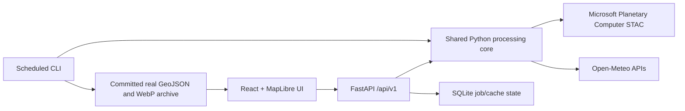

# Selat Melaka Oil Spill Watch

A GIS portfolio application for inspecting **candidate slicks** in real Sentinel‑1 VV SAR scenes around the Strait of Malacca and Singapore Strait. Results include measured area, transparent score features, scene-time weather context, first-order 6/12/24-hour drift, review imagery and a scene history archive.

> **Candidate slick detection, not confirmed spill.** Scores are 0–100 documented heuristics, not probabilities. Educational and research use only—not for operational, legal, or emergency decisions.

Sentinel‑1 imagery is near-real-time at best (often hours of latency), and a location is revisited roughly every 6–12 days. Live describes weather/ocean-current model context and optional AIS, not live satellite imagery.

## Real-data only

The app has no demo case, synthetic fallback, or placeholder result. Every analysis is tied to a Planetary Computer Sentinel‑1 STAC item. The result shows the exact scene ID and public STAC link, acquisition UTC time and age, satellite, orbit direction and VV polarization. If STAC or scene loading fails, the job reports its error and no result is shown. Missing scene-time wind remains explicitly unavailable and reduces candidate scores; it is never filled with a made-up value. A zero-candidate scene is a valid result.

All successful results include matching raw and Lee-filtered VV dB WebP overlays generated from the exact AOI array used by processing. Fixed grayscale stretch is −25 to 0 dB; auto stretch is per-scene p2–p98. The map provides pixel inspection, AOI and scene outlines, candidate outlines, a raw/filtered swipe curtain, and synchronized side-by-side maps. Manual reviewer notes and checklist are local to the browser and exportable; they are not system confirmation.

## Preview

Captured from real Sentinel‑1 scene `S1D_IW_GRDH_1SDV_20261002T113320_20261002T113345_004836_009162_rtc` (2026-10-02 11:33:32 UTC). This real scene produced **2 candidate slicks (0.090 km² total)**. The screenshot comparison shows the raw image, the filtered image with candidate polygons enabled, and the swipe view. Candidate outlines represent detector output only, not verified oil.


## Architecture



- `/core`: STAC, bounded AOI reads, SAR preparation, dark-region detector, score, drift, QA, preview assets.
- `/api`: FastAPI jobs, validation, rate limits, live conditions, pixel/profile inspection and archives.
- `/web`: Vite/React/TypeScript, MapLibre, responsive review interface, lazy drift/history visualizations.
- `/pipeline`: idempotent real-scene archive ingestion and Natural Earth refresh.
- `/data/archive`: permanent GeoJSON + small raw/filtered WebP history. SQLite is disposable state.
- `/validation`: sourced public incident checks and real scene metrics. Test-only synthetic fixture is in `/tests`.

## Data attribution

Copernicus Sentinel‑1 via Microsoft Planetary Computer; Open‑Meteo forecast/archive and marine APIs; Natural Earth public-domain land data; © OpenStreetMap contributors; OpenSeaMap seamarks; optional aisstream.io. A server-side AIS streaming relay is not currently active, and the browser never receives the AIS key.

## Run locally

Requires Docker Desktop with its Linux engine:

```sh
docker compose up --build
```

Open `http://localhost:5173` and `http://localhost:8000/docs`. Real scene discovery/analysis needs outbound network access to Planetary Computer and Open‑Meteo. There is no offline analysis substitute. OSM/OpenSeaMap tiles need network access too.

Without Docker, use Python 3.11 and Node 22:

```sh
uv sync --frozen --extra dev
uv run uvicorn api.main:app --reload
```

In a second terminal:

```sh
cd web
npm ci
npm run dev
```

## API

See `docs/API.md`. OpenAPI docs are served at `/docs`. API paths are under `/api/v1`; AOIs are constrained to 95.0–104.5°E, 0.8–7.0°N and at most 60×60 km. Result assets are fixed/auto, raw/filtered WebP; all use the matching real scene ID.

## Validation

```sh
uv run ruff check core api pipeline tests
uv run mypy --follow-imports=skip core api pipeline
uv run pytest -q
cd web && npm run lint && npm run build && npm test
```

A network-dependent browser test can run one real scene by setting `REAL_SCENE_ID` to a real Planetary Computer STAC item ID before `npm run e2e`. It is skipped when no scene ID is supplied; it never loads a fake result. To archive recent real scenes:

```sh
uv run python -m pipeline.ingest --days 60
```

The scheduled GitHub Action processes new scenes and commits the archive only after a successful complete ingestion. It supports daily and manual triggers. Archive is size-capped at 50 MB. See `validation/report.md` for actual command outcomes, archive metrics, the source-verified worldwide case register, and the cases whose scene matches and detector outcomes could not be verified in this environment.

## Deploy

See `docs/DEPLOY.md` for frontend static hosting, backend Docker, CORS, and GitHub Actions. Deployments require your own hosting accounts, a reachable public API URL, and repository write permission for scheduled archive commits. AIS also needs a server-only aisstream.io key and a working relay. No secret is committed; see `.env.example`.

## Limitations

Dark water is not unique to oil. Low wind, rain, algae, biogenic films, wakes, bright ships, shadows, and ports cause false positives/negatives. Sentinel‑1 RTC/GRD coverage and weather availability vary. GRD fallback is explicitly marked radiometry-uncalibrated. The detector is a candidate-screening heuristic with no verified IoU ground truth so far. Drift is a first-order estimate, not a Lagrangian model. See `docs/METHODOLOGY.md`, `docs/DECISIONS.md`, and `validation/report.md`.
