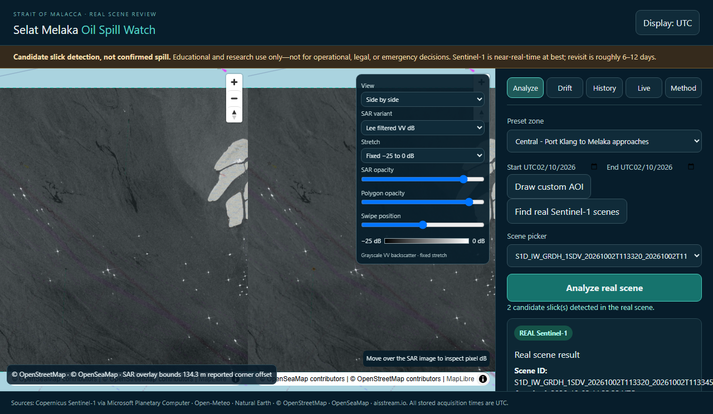
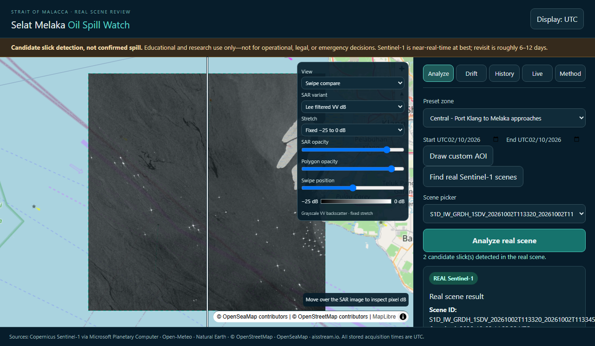

# Real-data validation report

**Run date:** 2026-10-26 UTC. **Policy:** reported scene metrics below come from actual Sentinel-1 observations and actual API responses. The case register contains source-verified literature/agency incident metadata only; it is not a set of detector outputs. No demo records or synthetic metric values are included. Synthetic numerical fixtures remain under `tests/` only and are excluded from reported measured results.

## Expanded real-world validation case register (source verification only)

`cases.yaml` now contains five documented spill incidents (Princess Empress, Sanchi, X-Press Pearl, Huntington Beach/Pipeline P00547, Grande America) and four natural seep sites (Coal Oil Point, GC600, Bush Hill, MC118), with primary/scientific source URLs. Incident extents are transcribed as reported dimensions/areas where sources provide them; they are not converted into polygons. Seep locations are site-level backgrounds, not dated spill labels.

**No scene matching or detector processing was completed for these nine worldwide cases in this run.** Direct requests to the Planetary Computer STAC endpoint from the Python runtime failed with `PermissionError: [Errno 13] Permission denied`; network access through web search allowed source checks but not catalogue/API requests or raster retrieval. Therefore every new case has `scene_search.status: not_verified`, null scene ID/time gap, and null detector result. No candidate count, detected/missed label, distance, IoU, wind, funnel, detection rate or false-alarm change is reported for these cases. Do not interpret “unverified” as “no scene” or “not detected.”

The app's **Validation cases** tab and `/api/v1/validation/cases` endpoint expose these sourced records and explicitly show that there are no matched-scene results yet. They do not render a SAR image or polygons without an actual analysis result. No AOI-limit exception or case-specific global processing route was added, because no vetted case-to-scene association was available to authorize those larger requests.

Detector parameters were **not tuned** against the new cases. Existing measured same-scene before/after and 23-scene Malacca archive results remain in the sections below; they are not worldwide-case results. Scene matching via Planetary Computer, Copernicus Data Space and ASF, actual detector runs, case-specific polygon overlays and before/after false-alarm measurement remain unverified and are acceptance gaps.

## Commands and quality gates actually run

- `.venv\Scripts\python.exe -m pipeline.ingest --days 60` (after clamping floating point footprint overlap to [0, 100]): completed. STAC returned **23** usable RTC items across all three zones; **22 new entries** were staged and committed to the index because one central scene was already indexed. The command returned `archive_bytes: 4977394`, `days: 60`, `scenes_considered: 23`, `new_entries: 22`.
- `.venv\Scripts\python.exe -m pytest -q`: **13 passed**, 8 dependency deprecation/pending-deprecation warnings, 3.97 seconds.
- `.venv\Scripts\ruff.exe check core api pipeline tests`: passed.
- `.venv\Scripts\mypy.exe --follow-imports=skip --no-incremental core api pipeline`: passed (18 Python source files).
- In `web/`: `npm run lint`, `npm test`, `npm run build`: passed; Vitest **2 tests passed**. Vite emitted a bundle-size warning (main JS 1.218 MB minified, 341.25 kB gzip; lazy drift and history chunks are separate).
- In `web/`, PowerShell command: `$env:REAL_SCENE_ID='S1D_IW_GRDH_1SDV_20261002T113320_20261002T113345_004836_009162_rtc'; $env:PLAYWRIGHT_BROWSERS_PATH=(Resolve-Path '../work/pw-browsers').Path; npm run e2e -- --reporter=line`: **1 real-scene Playwright test passed**. It loaded the real STAC scene, ran analysis, waited for raw and filtered WebP map sources, verified rendered candidate line features, toggled swipe/side-by-side, and asserted the three review canvases after selecting a candidate. Screenshots are embedded below.
- `git diff --check`: passed. `docker compose config` is checked separately below.

Case-register additions and API/UI checks in this run:

- Actual direct-query probe: `.venv\Scripts\python.exe work\search_cases.py`; it failed before any catalog query with the network `PermissionError` above.
- `.venv\Scripts\pytest.exe -q`: **14 passed**, 8 third-party deprecation warnings (3.77 s).
- `.venv\Scripts\ruff.exe check core api pipeline tests`: passed; `.venv\Scripts\mypy.exe --follow-imports=skip --no-incremental core api pipeline`: passed (18 source files).
- In `web/`: `npm run lint`, `npm test -- --run` (**3 passed**), and `npm run build`: passed. Vite still reports the existing main bundle >500 kB warning.
- In `web/`: `PLAYWRIGHT_BROWSERS_PATH=<repo>/work/pw-browsers npm run e2e -- validation-cases.spec.ts --reporter=line`: **1 passed** (9 source cards, 23 source links, no unverified detector outputs). This tests the register tab only, not real-scene case analysis.
- `git diff --check`: passed.

## Real 60-day archive run

The run window was **2026-08-27 through 2026-10-26 UTC**. The complete index contains **23 real scene records**, all with a result even when the detector returned zero candidates. Current archive tree size is **5,184,258 bytes (74 files)**, below the 50 MiB limit. The largest archived raw preview is **131,250 bytes**; raw/filtered previews are each comfortably below 3 MiB. The raster archives are not committed; each scene has simplified GeoJSON and decimated raw/filtered WebP previews.

Preset bounding-box areas were computed geodesically from the configured AOI: North **3,061.410 km²**, Central **3,073.442 km²**, South **2,768.885 km²**. These are bounding-box exposure areas, not all-ocean surveyed area. Per-zone results:

| Zone | Real scenes | Candidate count | Candidate area | Observed candidates per 1,000 km²-scene exposure* |
|---|---:|---:|---:|---:|
| North | 9 | 1 | 0.047 km² | 0.0363 |
| Central | 5 | 2 | 0.090 km² | 0.1301 |
| South | 9 | 0 | 0 km² | 0 |
| **Total** | **23** | **3** | **0.137 km²** | **0.0442** |

\*This is a descriptive candidate-density calculation (`candidate count ÷ configured AOI bounding-box area ÷ scene count × 1000`), **not a false-alarm rate**. There are no independently verified no-spill labels across this scene sample, so a false-alarm rate per 1,000 km² cannot honestly be measured. The full per-scene count, area, QA valid-pixel percentage and flags follow. All acquisition timestamps are UTC.

| Zone | Acquisition UTC | Sentinel-1 scene ID | Candidates | Area km² | Valid pixels | QA flags |
|---|---|---|---:|---:|---:|---|
| central | 2026-08-27T11:33:32Z | `S1D_IW_GRDH_1SDV_20260827T113319_20260827T113344_004311_007F25_rtc` | 0 | 0.000 | 100.0% | offshore_platform_mask_unavailable |
| north | 2026-08-27T11:34:22Z | `S1D_IW_GRDH_1SDV_20260827T113409_20260827T113434_004311_007F25_rtc` | 0 | 0.000 | 94.7% | offshore_platform_mask_unavailable |
| north | 2026-09-02T23:02:59Z | `S1D_IW_GRDH_1SDV_20260902T230247_20260902T230312_004405_00826B_rtc` | 0 | 0.000 | 100.0% | wind_unavailable, current_unavailable, offshore_platform_mask_unavailable |
| south | 2026-09-03T11:24:57Z | `S1D_IW_GRDH_1SDV_20260903T112445_20260903T112510_004412_0082B1_rtc` | 0 | 0.000 | 100.0% | none |
| south | 2026-09-04T22:47:32Z | `S1D_IW_GRDH_1SDV_20260904T224720_20260904T224745_004434_008374_rtc` | 0 | 0.000 | 95.7% | none |
| central | 2026-09-08T11:33:32Z | `S1D_IW_GRDH_1SDV_20260908T113319_20260908T113344_004486_008541_rtc` | 0 | 0.000 | 100.0% | wind_out_of_range, offshore_platform_mask_unavailable |
| north | 2026-09-08T11:34:22Z | `S1D_IW_GRDH_1SDV_20260908T113409_20260908T113434_004486_008541_rtc` | 0 | 0.000 | 94.7% | offshore_platform_mask_unavailable |
| north | 2026-09-14T23:03:00Z | `S1D_IW_GRDH_1SDV_20260914T230247_20260914T230312_004580_00887A_rtc` | 0 | 0.000 | 100.0% | wind_unavailable, current_unavailable, offshore_platform_mask_unavailable |
| south | 2026-09-15T11:24:58Z | `S1D_IW_GRDH_1SDV_20260915T112445_20260915T112510_004587_0088BA_rtc` | 0 | 0.000 | 100.0% | none |
| south | 2026-09-16T22:47:33Z | `S1D_IW_GRDH_1SDV_20260916T224721_20260916T224746_004609_00897D_rtc` | 0 | 0.000 | 95.7% | none |
| central | 2026-09-20T11:33:32Z | `S1D_IW_GRDH_1SDV_20260920T113320_20260920T113345_004661_008B4A_rtc` | 0 | 0.000 | 100.0% | offshore_platform_mask_unavailable |
| north | 2026-09-20T11:34:22Z | `S1D_IW_GRDH_1SDV_20260920T113410_20260920T113435_004661_008B4A_rtc` | 1 | 0.047 | 94.8% | offshore_platform_mask_unavailable |
| north | 2026-09-26T23:03:00Z | `S1D_IW_GRDH_1SDV_20260926T230248_20260926T230313_004755_008E7F_rtc` | 0 | 0.000 | 100.0% | wind_unavailable, current_unavailable, offshore_platform_mask_unavailable |
| south | 2026-09-27T11:24:58Z | `S1D_IW_GRDH_1SDV_20260927T112445_20260927T112510_004762_008EC4_rtc` | 0 | 0.000 | 100.0% | none |
| central | 2026-10-02T11:33:32Z | `S1D_IW_GRDH_1SDV_20261002T113320_20261002T113345_004836_009162_rtc` | 2 | 0.090 | 100.0% | offshore_platform_mask_unavailable |
| north | 2026-10-02T11:34:22Z | `S1D_IW_GRDH_1SDV_20261002T113410_20261002T113435_004836_009162_rtc` | 0 | 0.000 | 94.8% | offshore_platform_mask_unavailable |
| south | 2026-10-09T11:24:58Z | `S1D_IW_GRDH_1SDV_20261009T112445_20261009T112510_004937_0094E6_rtc` | 0 | 0.000 | 100.0% | wind_out_of_range |
| south | 2026-10-10T22:47:33Z | `S1D_IW_GRDH_1SDV_20261010T224721_20261010T224746_004959_0095AF_rtc` | 0 | 0.000 | 95.7% | wind_out_of_range |
| central | 2026-10-14T11:33:32Z | `S1D_IW_GRDH_1SDV_20261014T113320_20261014T113345_005011_009780_rtc` | 0 | 0.000 | 100.0% | offshore_platform_mask_unavailable |
| north | 2026-10-14T11:34:22Z | `S1D_IW_GRDH_1SDV_20261014T113410_20261014T113435_005011_009780_rtc` | 0 | 0.000 | 94.7% | wind_out_of_range, offshore_platform_mask_unavailable |
| north | 2026-10-20T23:03:00Z | `S1D_IW_GRDH_1SDV_20261020T230247_20261020T230312_005105_009AAE_rtc` | 0 | 0.000 | 100.0% | wind_unavailable, current_unavailable, offshore_platform_mask_unavailable |
| south | 2026-10-21T11:24:58Z | `S1D_IW_GRDH_1SDV_20261021T112445_20261021T112510_005112_009AED_rtc` | 0 | 0.000 | 100.0% | none |
| south | 2026-10-22T22:47:33Z | `S1D_IW_GRDH_1SDV_20261022T224721_20261022T224746_005134_009BB1_rtc` | 0 | 0.000 | 95.7% | wind_out_of_range |
## Detector change measured on the same real scene

Scene `S1D_IW_GRDH_1SDV_20261014T113320_20261014T113345_005011_009780_rtc` acquired at **2026-10-14 11:33:32 UTC** was processed before and after the detector changes:

- Before: **500 candidate polygons**, **50.590 km²** total; this hit the old 500-output cap and was a clear detector failure/false-positive flood.
- After: **0 candidate slicks**, **0 km²**. On the same configured Central bounding box (3,073.442 km²), the pre-fix output density was **162.68 candidate polygons/1,000 km²** and the post-fix output density was **0**; these are candidate densities, not false-alarm rates. Funnel: raw dark **717** pixels → after land mask **638** → after ship/platform/port **638** → wind pass **638** → area components **0** → shape candidates **0** → final **0**. The valid AOI pixels were **100.0%**, sea-mask pixels **93.21%**, data age **280.0 h**, runtime **4.69 s**, working resolution **30 m**. STAC footprint overlap **100.00%**. The QA field's raster/AOI corner residual was **134.33 m**; this is the reported raster-to-AOI alignment residual, not the polygonization pixel-footprint mismatch.

The 2 October central scene listed above produced two candidates after the fixes: total **0.090 km²**, 100% valid AOI pixels, 30 m working resolution. Its funnel was raw dark **3,894** → after land **3,816** → after protected target/port mask **3,816** → wind pass **3,816** → area components **2** → shape candidates **2** → final **2**. This demonstrates the UI and output geometry on a real observation; it does not establish that either region is oil.

Old baseline file `data/archive/central/2026-10-14/3554619937f7a5a5b5005e6c.geojson` is a real but superseded pre-fix output and is **not referenced by the archive index or replayable in History**. It is retained as evidence for the measured before count. The indexed 14 October post-fix record is the zero-candidate output.

## Image, geometry and API checks

- Unit test `tests/test_core.py::test_polygonization_area_and_mask_alignment` round-tripped a known mask through polygonization/reprojection and back with **0 mismatched pixels**; projected boundary Hausdorff distance was **<0.001 m**. The analytic-area and raster-to-polygon comparison passed.
- `tests/test_core.py::test_real_sar_preview_georeferencing_and_fixed_stretch` passed: same-array WebP generation, AOI bounds, fixed-stretch determinism and size check. The actual result preview API returned HTTP 200 with `image/webp`; the largest archived raw image was 131,250 bytes.
- For the 14 October real scene, preview/AOI overlap with the STAC footprint measured **100.00%**; corner residual **134.33 m**. The same arrays supplied detector and preview; pixels outside AOI were excluded. The 2 October scene returned the same overlap/residual values. Scene outline and AOI outline are drawn separately.
- The successful browser run rendered the scene image, score-filtered candidates, side-by-side/swipe modes and candidate review crops. The screenshot scene contains 2 detector candidates and is identified in the UI as `REAL Sentinel-1`.

## Verified incident checks

Three incidents are supported by multiple public sources in `validation/incidents.yaml`:

1. **APL Denver / Wan Hai 301, 2017-01-03/04, Johor/East Johor Strait.** MPA and Reuters reporting document the incident. STAC returned no usable Sentinel-1 RTC or GRD scene in the queried ±3-day/50 km window; no detector run or overlap is claimed. [MPA](https://www.mpa.gov.sg/media-centre/details/collision-of-container-vessels-wan-hai-301-and-apl-denver), [Reuters reporting, via gCaptain](https://gcaptain.com/bunker-spill-after-containerships-collide-in-east-johor-straits-near-singapore/).
2. **Pasir Panjang Terminal, 2024-06-14.** MPA and ITOPF document the spill. The matched RTC scene `S1A_IW_GRDH_1SDV_20240614T112543_20240614T112608_054318_069B9C_rtc` was acquired **5 h 7 min 55 s after** the reported 06:18 UTC event. A real detector run returned **0 candidates**; wind was outside the 2–10 m/s gate and flagged `wind_out_of_range`. Sources provide no georeferenced slick polygon, so distance and IoU were not computed. [MPA](https://www.mpa.gov.sg/media-centre/details/oil-spill-clean-up-in-progress-at-pasir-panjang-terminal), [ITOPF](https://www.itopf.org/in-action/case-studies/marine-honour-singapore-2024/).
3. **Pulau Ubin / Tanjung Langsat, 2025-04-03.** MPA, Malaysia DOE and Bernama document the oil patch and pipeline source. STAC returned no suitable Sentinel-1 RTC/GRD scene in the queried ±3-day window; no detector run or overlap is claimed. The reported released volume is not treated as slick extent. [MPA](https://www.mpa.gov.sg/media-centre/details/oil-patch-sighted-in-the-eastern-johor-strait-off-the-northeastern-coast-of-pulau-ubin), [Malaysia DOE notice](https://www.doe.gov.my/wp-content/uploads/2025/08/KM-4-April-2025.pdf), [Bernama](https://www.bernama.com/en/news.php?id=2409099).

No verified incident case produced a detected candidate in these matched checks. The 2024 zero-candidate output has no verified surface extent for an IoU calculation. The incident point locations are source descriptions, not invented coordinates.

## Measured live conditions and unverified claims

On 2026-10-26 UTC, `GET /api/v1/live/conditions?bbox=100.8,2.65,101.3,3.15` returned HTTP 200 from Open-Meteo forecast and Marine APIs. Wind and current values were labelled as model output with source/time metadata. No AIS streaming relay was configured; vessel positions were unavailable. Current is not buoy observation. Optical Sentinel-2 lookup was implemented but no scene match was needed to produce the screenshots; optical matching across every archive observation was not verified.

`docker compose config` can validate the Compose file, but **Docker image build / `docker compose up` were not verified** because Docker Desktop's Linux engine was unavailable in this environment. Remote GitHub Actions, Vercel, Hugging Face Spaces and aisstream.io credentials/relay were not deployed or verified. First-load under 3 seconds, 60 fps at 500 polygons, and under 3 minutes on the free hosting tier were not benchmarked. Public incident pages were consulted for this report; run-specific scene STAC and weather requests completed locally.

## Screenshots from the 2 October real scene

Scene `S1D_IW_GRDH_1SDV_20261002T113320_20261002T113345_004836_009162_rtc` is shown below. It has 2 *candidate* polygons from this detector run; there is no independent confirmation that they are oil.

## Legacy empty files blocked by filesystem policy

The environment rejected deletion of two tracked legacy paths. Their contents are empty (0 bytes), and no app/API/pipeline code reads or serves either one: `docs/screenshots/offline-demo.png` and `web/public/demo-case.json`. The app has no demo route or fallback, and `core/synthetic.py` is removed. Physical deletion of these two zero-byte paths remains not completed because the filesystem sandbox denied it.

## Known limitations

The 23-scene count is small, biased to scenes returned by the current RTC catalog query, and largely unlabelled. The detector has not been calibrated against a verified slick geometry. The sample includes wind/current gaps and incomplete offshore-platform masking. The score is a rule-based 0–100 heuristic, not a probability. No claim of incident detection, scientific sensitivity/specificity, or false-alarm rate is supported. See `docs/METHODOLOGY.md` for parameters and physical limitations.
